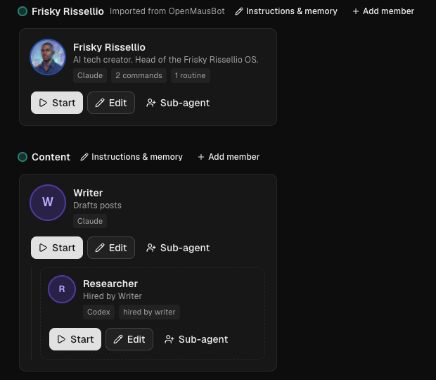
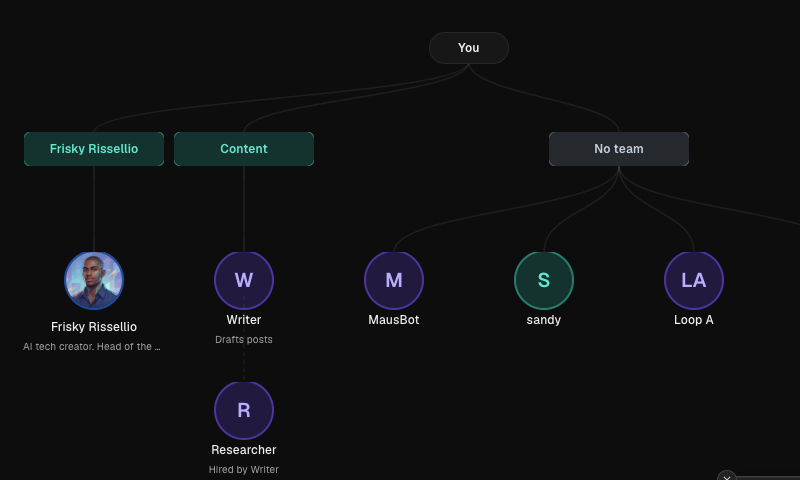

# Orca Pod

**Orca Pod is [Orca](https://github.com/stablyai/orca) with a team of named agents built in.**
A pod is what a group of orcas is called. Orca Pod is that group: agents with names, faces and
personalities that work in teams and can hire their own helpers.

It is an unofficial fork of Orca 1.4.259 (MIT license, © Lovecast Inc.) and is not affiliated
with or endorsed by the Orca team. Everything Orca does, Orca Pod does too. This page lists what
was added and what was changed.

<p>
  
  
</p>

## What it adds

**Agents page** (sidebar → Agents)

- A card for each agent, with its picture, name, job title, engine (Claude, Codex, Hermes, Gemini,
  OpenCode or Cursor) and slash-commands. Once the agent is started, the card shows a live status dot.
- **New agent**: name, picture, colour, personality and instructions, engine, model, team, who it
  works for, working folder and commands.
- **Start** opens the agent in a normal Orca terminal tab named after it, in its own folder when
  that folder is open in Orca. Claude gets the agent's personality, team rules and memory as real
  system instructions (`--append-system-prompt-file`). Other engines get them in the first message.

**Teams**

- Shared instructions that every member reads when it starts.
- A **department memory** file the whole team writes to. While you edit it, a save never
  overwrites what an agent added in the meantime.
- A team lead.

**Sub-agents**

- Add one from any card ("Sub-agent"). An agent can also hire its own: its brief tells it how to
  write `~/.orca-teams/agents/<id>/agent.json`. The new hire shows up on the page within seconds,
  marked "hired by …". It never starts on its own.

**Team map**: you → teams → agents → sub-agents, with pictures and live status.

**Import from OpenMausBot**: brings in bots from `~/.openmausbot` (name, picture, personality,
section as team, skills as commands, memory, routines as notes). It only reads OpenMausBot's
files and never changes them. Running it again skips bots it already imported.

## How agents are stored

Plain files you (or an agent) can edit, in `~/.orca-teams/`:

```
~/.orca-teams/
  agents/<id>/agent.json   profile (checked against a schema on every read)
  agents/<id>/MEMORY.md    the agent's own memory
  agents/<id>/BRIEF.md     written fresh at every start: who it is, team rules, memory paths
  teams/<id>/team.json     name, lead, shared instructions
  teams/<id>/MEMORY.md     department memory
```

Agents can write these files, so every read is validated. A bad file is listed at the top of the
page with the reason, instead of crashing the app or being silently ignored. A picture file name
or model that could reach outside the agent's folder or add a command-line flag is refused.

## Runs beside stock Orca

Orca Pod has its own identity, so both apps can be installed at once:

|               | Stock Orca                           | Orca Pod                             |
| ------------- | ------------------------------------ | ------------------------------------ |
| App profile   | `~/Library/Application Support/orca` | `…/orca-teams`                       |
| Bundle id     | `com.stablyai.orca`                  | `com.frisky.orca-teams`              |
| Link scheme   | `orca://`                            | `orca-teams://`                      |
| Keychain item | "orca Safe Storage"                  | "orca-teams Safe Storage"            |
| Self-update   | from Orca releases                   | off (updates come by merging, below) |

The ids still say `orca-teams`, the fork's first name, so installs made before the rename keep their
profile and saved logins. Every identity is set in `src/shared/app-flavor.ts`.

Usage analytics: Orca sends them only from its makers' official builds, which need a secret key.
Orca Pod builds don't have that key, so they send nothing.

## Build it

macOS, Node 24, pnpm via corepack:

```bash
corepack pnpm install && corepack pnpm -C mobile install
corepack pnpm run build:unpack
codesign --force --deep --sign - "dist/mac-arm64/Orca Pod.app"
```

The app is signed on your own machine, not by Apple, so the first time you open it, right-click → Open.

## Keeping up with Orca

Our changes are a short list of commits on top of an Orca release tag. To move to a newer Orca,
replay them (`git cherry-pick <base-tag>..orca-pod`) onto the new tag, then run
`pnpm run tc:node && pnpm run tc:web && pnpm run lint` and the tests. Most of our code is in new
folders. Expect a few conflicts in the shared files listed below. The generated translation
catalogs always conflict: keep the new release's copy, then run `pnpm run sync:localization-catalog`.

## Where the code is

- `src/shared/app-flavor.ts`: the app's identity
- `src/shared/agent-teams/`: data model, brief, launch arguments, link resolution (with tests)
- `src/main/agent-teams/`: file store, folder watcher, OpenMausBot import (with tests)
- `src/main/ipc/agent-teams/`, `src/preload/api/agent-teams/`: the bridge to the window
- `src/renderer/src/components/agent-teams/`: Agents page, editors, team map
- Small hooks into Orca's own files: the sidebar button, the page shell, the view lists, the
  updater switch, and `config/electron-builder.config.cjs`

## Checked before publishing

- Orca's own unit suite (about 28,400 tests): the only failures specific to the fork were Orca's
  updater tests, now fixed. The other failures also fail on unmodified Orca 1.4.259 on the same
  machine (they depend on the machine's setup).
- Orca's type checks and all 46 lint and design-system steps pass, including translations for
  every on-screen word.
- Clicked through in a separate test profile:
  - import, and re-import skipping duplicates
  - team map, including an agent hiring loop
  - a sub-agent written as a file appearing live
  - bad files reported instead of loaded
  - a Claude agent starting in its own folder with its brief, and a Codex agent starting with its model
  - team memory protected while editing
  - remove asking first
  - creating an agent from the form

## Not done yet

- Routines as scheduled Orca automations (imported routines are notes for now).
- Agent cards in Orca's phone app.
- Agent pictures in Orca's own tab bar (tabs show the agent's name).
- Screens are in English only. The text is ready for translation, but no other languages are filled in yet.

## License

MIT, same as Orca. See [LICENSE](LICENSE). The original copyright notice is kept.
